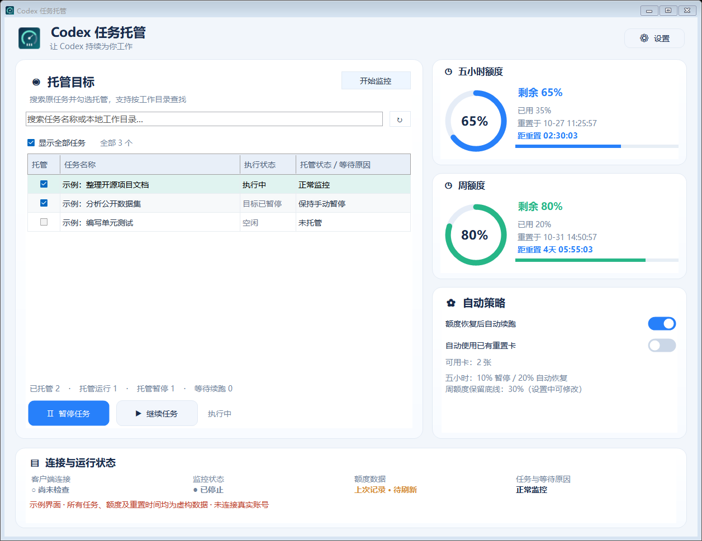
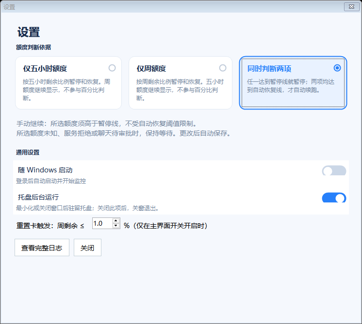

# Codex 任务托管

[](https://github.com/jiyan1989/codex-quota-manager/releases/latest)
[](LICENSE)
[](https://github.com/jiyan1989/codex-quota-manager/releases)
[](https://github.com/jiyan1989/codex-quota-manager/releases/latest)
[](#从源码构建)
[](#下载与运行)
[](#可选-codex-集成)
[](#可选-codex-集成)

Windows 本地 Codex 额度监控与任务托管工具。在五小时额度接近暂停线时暂停所选任务，额度恢复后按设置继续；独立的周额度保留底线始终生效，避免五小时反复刷新后持续消耗周额度。

[下载运行版](https://github.com/jiyan1989/codex-quota-manager/releases/latest) · [使用与设置](#使用与设置) · [更新说明](docs/updates.md) · [已知问题](docs/known-issues.md)

当前发布版本为 **v1.5.2**。

## 软件界面

图片使用虚构任务和额度渲染，不包含真实账号或聊天。示意图为 v1.5.0 布局参考；后续精简见下文，以当前程序为准。

### 主界面



v1.5.2 起主界面仅保留“暂停任务／继续任务”，不再提供开始／停止监控按钮；后台保护随常规启动自动运行，异常退出后按间隔重连。左侧搜索任务名称或工作目录，选择原聊天托管；右侧显示双额度和策略摘要；底部显示连接、监控、数据新鲜度和等待原因。运行、暂停和待续数量仅统计托管任务。

### 设置界面

下图为 v1.5.0 的布局参考；v1.5.1 已将底部精简为一个随状态切换的更新按钮及日志入口，关闭使用右上角 X。



三项额度数值集中放在“设置 → 额度保护”，主界面只读显示策略摘要。

## 下载与运行

从发布页下载 ZIP，解压后双击 `CodexQuotaMonitor.exe`。需要 Windows x64、.NET Framework 4.5+、PowerShell 7，以及已登录的 Codex 桌面客户端。PowerShell 7 可安装到 PATH，或使用程序可发现的 Codex 内置运行环境。

首次使用默认不选择任何任务。只勾选明确希望交给程序控制的原聊天。不会因输入本地路径而新建聊天。

## 使用与设置

1. 搜索已有任务，勾选托管；取消勾选可解除后续自动暂停与继续控制。
2. 右上角“设置 → 额度保护”分别设置五小时暂停线、五小时自动恢复线及周额度保留底线。
3. 在主界面选择是否开启“额度恢复后自动续跑”。关闭后仍保护暂停，手动继续可独立使用。
4. 按需开启随 Windows 登录启动或托盘后台运行。最小化、关窗和退出行为见设置注释。

新安装默认五小时剩余 ≤10% 暂停、≥20% 允许自动恢复，周额度剩余 ≤10% 暂停。旧版升级会备份设置，并保留原有的三项数值，不擅自替换为示例数字。旧版互斥的判断依据已迁移为“五小时控制＋周底线”。

| 条件 | 行为 |
| --- | --- |
| 五小时剩余 ≤ 暂停线，或周剩余 ≤ 保留底线 | 暂停托管任务 |
| 五小时达到自动恢复线，且周剩余高于底线 | 开启自动续跑时，核实原任务后恢复 |
| 手动继续 | 五小时须高于暂停线、周剩余须高于底线；不必达到自动恢复线 |
| 五小时刷新为100%，但周剩余已到保留底线 | 继续保持暂停 |
| 任一所需额度未知或服务端拒绝使用 | 暂停／等待，不放行恢复 |
| 人工保持暂停 | 不因额度回升自动解除，需明确继续 |

自动恢复线必须高于五小时暂停线；周底线独立设置，不随另外两项变化。例：五小时10%暂停、20%恢复、周底线30%，表示周额度须大于30%才可继续。界面的等待原因会显示实际余额和拦截条件。

## 托管与后台

- 主界面只控制选中任务的暂停和继续；暂停任务保持人工暂停，后台仍继续读取额度。
- 全局停止入口统一为托盘“退出管家（停止额度保护）”。退出停止后台保护，不会据此中断当前任务。内部更新、诊断启动仍保留停止机制。
- 符合恢复条件但尚未加载的原聊天会自动打开，并在核实原身份、状态和额度后继续；加载未确认时按间隔重试，不新建聊天。
- 取消托管、保持手动暂停或自动续跑关闭时，不会凭旧记录自动打开原聊天；明确请求手动继续可触发加载。
- 已经发送给客户端的请求无法撤回；取消托管后不会继续据旧记录发送新控制请求。
- 两项额度显示重置时刻和倒计时。倒计时结束仍等待真实额度确认，不直接视为已经刷新。

## 已有重置卡

默认关闭“自动使用已有重置卡”，不会自动购买卡或额度。明确开启后，后台按设置中的周剩余触发值使用已有卡并核实结果。重置卡不会绕过周额度保留底线的恢复检查。

## 版本更新

v1.5.0 起支持启动时及每天自动检查、发现新版提醒、手动检查和一键更新。自动检查只提醒，不会静默安装；设置中只保留一个更新按钮：未发现新版时显示“检查更新”，发现新版后显示“一键更新”；点击后才下载安装。设置页通过右上角 X 关闭。

更新优先读取 GitHub 仓库中的公开清单，API 作为备用；无需账号密钥，不上传任务或账户信息。下载后核对来源、SHA-256 校验值及程序版本，只替换 EXE，保留设置、托管记录、人工暂停及安装时的监控开关状态。下载或校验失败保留现有运行；新版未能启动则自动恢复旧版。

**v1.4.1 及更早版本没有更新入口，需要先手动升级一次到 v1.5.0 或更高版本。**详见[更新说明](docs/updates.md)。

## 本地数据与隐私

本地数据位于 `%LOCALAPPDATA%/CodexQuotaManager`，包括设置、原任务标识、标题、工作目录、日志及更新备份。这些文件可能含隐私，不要直接提交到公开仓库或问题反馈。

本仓库不附带用户聊天、账号配置或真实运行截图。程序不设遥测服务；可选 MCP（模型上下文协议）桥接使用本地标准输入输出，无网络监听端口。额度与任务控制通过已登录的本机 Codex 完成，更新检查仅访问本项目的公共 GitHub 资源。

换电脑需单独部署；登录相同账号不会同步程序和托管记录，不要多台电脑同时接管同一任务。

## 限制

- 非 OpenAI 官方产品。使用 Codex 本机 app-server（应用服务）及桌面 IPC（进程间通信），客户端更新可能影响兼容性。
- 轮询与同步存在延迟，不能保证购买积分零消耗。
- 自动继续原聊天会消耗正常额度；输入、审批和任务身份检查仍生效。
- 模拟检查不能替代真实跨重置周期及客户端完整重启验收，进度见已知问题文档。

## 从源码构建

在项目目录使用 PowerShell 7：

```powershell
pwsh -NoProfile -File ./build.ps1
pwsh -NoProfile -File ./test.ps1
pwsh -NoProfile -File ./monitor/check-manager.ps1
pwsh -NoProfile -File ./monitor/check-quota-basis.ps1
pwsh -NoProfile -File ./monitor/check-manual-recovery.ps1
pwsh -NoProfile -File ./tools/check-ui-actions.ps1
pwsh -NoProfile -File ./tools/check-updater.ps1
python -X utf8 ./integration/test_mcp.py
```

产物为 `dist/CodexQuotaMonitor.exe`。使用 Windows .NET Framework C# 编译器，无第三方 NuGet 依赖。`--no-start` 只打开窗口；`--tray` 启动并进入托盘。

## 可选 Codex 集成

Python 3.10+ 可运行 `integration/manager_mcp.py`，在 Codex MCP 配置中指定脚本的实际绝对路径。基本窗口功能不依赖此集成。

```toml
[mcp_servers.codex_quota_manager]
command = "python"
args = ["-X", "utf8", "/replace/with/absolute/path/integration/manager_mcp.py"]
```

提供状态查询、任务查询、显式托管及全局控制。聊天内请求可以唤醒已打开但停止监控的程序。排队不代表已经恢复，请查询实际状态和等待原因。

## 卸载

在设置中关闭随 Windows 启动，从托盘退出，再移除程序文件；已配置 MCP 的用户需移除对应配置。需要清除记录时，可自行删除上述本地数据目录。

## 来源与许可证

基于 [cat2mao/codex-quota-monitor](https://github.com/cat2mao/codex-quota-monitor) 的 MIT 许可代码修改，保留上游版权与许可。本仓库从公开源码快照独立记录提交，贡献者统计不代表原有代码全部由本仓库维护者创作。见 [LICENSE](LICENSE) 和 [第三方声明](THIRD_PARTY_NOTICES.md)。
